# AJ Car Rentals — Database Architecture and Prisma Data Model

**Status:** Review proposal only. No application services, migrations, seeds, or database changes are included.  
**Backend:** Node.js 22, JavaScript ES modules, modular monolith, Prisma ORM, MySQL 8.  
**Repositories:** Backend and frontend remain separate Git repositories. The frontend calls the backend REST API; it never connects to MySQL directly.

> The existing lowercase [database-design.md](./database-design.md) is preserved. This uppercase document is the expanded proposal for the current review. The complete Prisma model proposal is in [schema.proposed.prisma](../prisma/schema.proposed.prisma); it is deliberately not duplicated inline, so there is one canonical schema text to review and no two copies that can drift. The schema file is not an active migration input.

## 1. Architecture overview

Use a normalized relational model for mutable operational state and financial transactions. Preserve historical meaning with append-only status, approval, payment, and audit records, plus immutable booking snapshots. Use JSON only for policy snapshots, system settings, and safe audit/notification metadata where fields are intentionally flexible.

Primary keys are UUID strings stored as MySQL `CHAR(36)` and generated by Prisma. This is portable across environments and avoids exposing sequential IDs. Use `DECIMAL(12,2)` for money, an explicit `CHAR(3)` currency code, and integer kilometre readings. Do not use `FLOAT` or `DOUBLE` for monetary values.

Store instants as UTC in `DATETIME(3)`. MySQL `DATETIME` has no timezone semantics: API inputs must be timezone-aware, normalized to UTC before persistence, and rendered in the business timezone (`Asia/Colombo` proposed). Use `DATE` for date-only values such as licence expiry. LKR is the proposed default, not a reason to omit currency columns from transactional records.

### Backend module boundaries

| Backend module | Principal models | Owns |
|---|---|---|
| Identity and access | `StaffUser`, `Role`, `Permission`, `StaffRole`, `RolePermission`, `StaffSession` | Staff identity, permission assignments, revocable sessions. |
| Fleet | `Vehicle`, `VehicleSpecification`, `VehicleImage`, `VehicleDocument`, `VehicleStatusHistory` | Vehicle identity, searchable specifications, lifecycle and media metadata. |
| Pricing | `RentalPackage`, `VehicleRate`, `PricingRule` | Package definitions, effective vehicle rates and quote-time pricing rules. |
| Customers | `Customer`, `CustomerContact`, `CustomerDocument` | Contact details, protected identity data and private documents. |
| Bookings and availability | `Booking`, `BookingReferenceCounter`, `BookingStatusHistory`, `BookingScheduleChange`, `BookingCharge`, `VehicleAvailabilityBlock`, `AvailabilityBlockHistory` | Requests, confirmed commitments, price snapshots and reservation conflicts. |
| Rental operations | `RentalHandover`, `HandoverAccessory`, `RentalReturn`, `ReturnAccessory`, `RentalInspection`, `InspectionPhoto`, `DamageReport`, `DamageImage`, `DamageResolution` | Handover/return evidence, odometer/fuel readings, accessories and damage lifecycle. |
| Payments | `Payment`, `PaymentAllocation`, `PaymentReceipt`, `DepositApplication` | Cash movements, refunds, allocation to rental/deposit balances and receipts. |
| Maintenance | `MaintenanceCategory`, `MaintenanceSchedule`, `MaintenanceJob`, `MaintenanceDocument` | Planned/actual work, service reminders, downtime and supporting evidence. |
| Expenses | `ExpenseCategory`, `Expense`, `ExpenseApprovalHistory`, `ExpenseDocument` | Operating costs, approval trail and receipt evidence. |
| Governance and configuration | `AuditLog`, `Notification`, `BusinessProfile`, `RentalPolicy`, `SystemSetting` | Audit, staff inbox and versioned business configuration. |

This design intentionally omits `BookingItem`: one booking reserves one vehicle. If multi-vehicle bookings become a requirement, introduce a booking header plus booking-vehicle line model in a separately reviewed migration.

## 2. Entity catalogue

The linked Prisma proposal defines every field, MySQL native type, nullability, key, relation, default and index. The tables below explain each model’s responsibility and the important relationship rule.

### Identity and access

| Model | Purpose and relationship |
|---|---|
| `StaffUser` | Staff account, normalized unique email, password hash, status and lifecycle timestamps. One-to-many to sessions, audit/operational actor records, and many-to-many to roles. Disable rather than delete. |
| `Role` | Extensible named role. Seed the codes `ADMIN`, `MANAGER`, `MAINTAINER`; the names are not hard-coded authorization checks. `ADMIN` receives all approved permissions; `MANAGER` receives operational permissions subject to restricted admin/sensitive actions; `MAINTAINER` receives handover, return, inspection and maintenance permissions, not financial/admin permissions. Exact permission codes remain configurable and need approval. |
| `Permission` | Stable permission code such as `booking.confirm` or `expense.approve`. |
| `StaffRole` | Join table for staff-to-role assignment; composite primary key prevents duplicate assignments. |
| `RolePermission` | Join table for role-to-permission grants; composite primary key prevents duplicate grants. |
| `StaffSession` | Hash of a random session token, expiry, last-use and revocation timestamps. Raw tokens are never stored. Sessions are many per staff account and can be individually revoked. |

### Fleet and pricing

| Model | Purpose and relationship |
|---|---|
| `Vehicle` | Fleet identity, unique registration, nullable current odometer cache until first reading, description, active/inactive/retired status. Has one specification and many images, documents, rate histories, bookings and maintenance records. |
| `VehicleSpecification` | One-to-one searchable make/model/variant, year, engine CC, fuel, transmission, colour and seating data. Kept separate from registration/lifecycle identity. |
| `VehicleStatusHistory` | Append-only vehicle state transition with actor, reason and time. Current status remains on `Vehicle` for efficient filtering. |
| `VehicleImage` | Multiple vehicle image metadata rows; only published images may be used for public display. Storage key is not a public URL. |
| `VehicleDocument` | Private registration, insurance, revenue licence, emissions and other document metadata. Expiry is recorded per document rather than copied to the vehicle. |
| `RentalPackage` | Reusable daily/weekly/monthly package definition, period/count, conditions and active flag. It contains no vehicle-specific price. |
| `VehicleRate` | Effective-dated price, mileage allowance, extra-kilometre rate and security deposit for one vehicle/package pair. Historical values are copied to a booking. |
| `PricingRule` | Optional global, package-specific, or vehicle-specific fixed/percentage discount or surcharge with effective dates and priority. Rules are applied at quote time; the result is snapshotted as booking charges. |

### Customers and bookings

| Model | Purpose and relationship |
|---|---|
| `Customer` | Contact information, encrypted NIC/licence values, keyed lookup hashes, status and internal notes. One customer has many contacts, documents and bookings. |
| `CustomerContact` | Alternate or emergency contact, with type, relationship, phone and primary flag. A customer may have multiple contacts. |
| `CustomerDocument` | Private NIC/licence/supporting-file metadata and opaque storage key. Multiple documents per customer. |
| `BookingReferenceCounter` | One row per reference year, atomically incremented when creating a booking. |
| `Booking` | One customer, one vehicle, one package, pickup/return, lifecycle, estimate/confirmed totals, snapshots of customer/vehicle/package conditions/rate/terms, source, and cancellation/rejection details. |
| `BookingStatusHistory` | Append-only old/new status, actor, reason and timestamp. |
| `BookingScheduleChange` | Old/new pickup and return instants, actor and reason; preserves extension or other schedule-change history rather than silently replacing dates. |
| `BookingCharge` | Positive amount with debit/credit direction for rental, discount, extra kilometres, late return, damage, cleaning, delivery or other charges. Includes voiding and revenue-recognition timestamps. |
| `VehicleAvailabilityBlock` | Vehicle downtime with reason, half-open interval, active/released/cancelled state and optional unique link to a maintenance job. |
| `AvailabilityBlockHistory` | Append-only status transitions for an availability block. |

### Rental operations and damage

| Model | Purpose and relationship |
|---|---|
| `RentalHandover` | At most one handover per booking; staff, time, starting odometer and fuel. Vehicle/customer are reached through the booking to avoid duplicate foreign keys. |
| `HandoverAccessory` | Snapshot of each accessory and quantity issued with the vehicle. |
| `RentalReturn` | At most one return per handover; staff, time, ending odometer and fuel. |
| `ReturnAccessory` | Quantity returned for each issued accessory; missing quantity is derived and checked against the handover snapshot. |
| `RentalInspection` | Handover, return or additional inspection; links to exactly one relevant handover/return, with condition notes, inspector and customer acknowledgement. |
| `InspectionPhoto` | Private photo metadata for an inspection. |
| `DamageReport` | Damage category, severity, pre-existing/new origin, location, description, estimate and status; tied to an inspection for direct pre/post-rental comparison. |
| `DamageImage` | Private evidence images for a damage report. |
| `DamageResolution` | Append-only resolution events. Actual repair spend is obtained from linked maintenance expenses rather than duplicated here. |

### Payments, maintenance, expenses and governance

| Model | Purpose and relationship |
|---|---|
| `Payment` | One actual collection or refund movement, linked to one booking, with advance/partial/final/deposit purpose, method, amount, reference, status, idempotency key and optional original collection for refunds. |
| `PaymentAllocation` | Splits one movement into rental, security-deposit, or other amounts. Allocation totals must equal the payment amount before completion. |
| `PaymentReceipt` | Private receipt evidence; multiple receipts may accompany a payment. |
| `DepositApplication` | Records a held security deposit applied to an identified booking charge. This is not a cash transaction. |
| `MaintenanceCategory` | Configurable service/repair classification. |
| `MaintenanceJob` | Vehicle service/repair, category, provider, schedule/actual dates, odometer, next service date/mileage, estimates, status, downtime block, documents and linked expenses. Actual total is not stored here. |
| `MaintenanceSchedule` | Recurring/date/mileage due rule for one vehicle/category; can generate multiple maintenance jobs. |
| `MaintenanceDocument` | Private maintenance invoice/report/document metadata. |
| `ExpenseCategory` | Configurable reporting category. |
| `Expense` | Amount, currency, date, vendor, method, status, submitter/approver, optional vehicle and/or maintenance-job link, deduplication key and attached documents. |
| `ExpenseApprovalHistory` | Append-only approval/rejection/void status transitions with actor and note. |
| `ExpenseDocument` | Private receipt and supporting-document metadata. |
| `Notification` | Staff-specific inbox item with type, read time, subject reference and safe payload. It is not the audit record. |
| `AuditLog` | Actor, action, entity reference, timestamp, request correlation, and carefully filtered before/after metadata. Append-only by application policy. |
| `BusinessProfile` | Single business profile, public contact details, timezone and reporting currency. |
| `RentalPolicy` | Versioned rental and cancellation terms with effective dates; booking stores the accepted terms snapshot. |
| `SystemSetting` | Keyed JSON values for non-secret operational settings, including booking settings. Secrets belong in deployment environment configuration, not this table. |

Customer payment history is obtained through `Customer -> Booking -> Payment`; it is not duplicated on the customer row. Vehicle insurance/licence expiry is derived from the corresponding `VehicleDocument.expiresAt`, avoiding a second editable copy.

## 3. Relationships and cardinality

- Staff users and roles are many-to-many through `StaffRole`; roles and permissions are many-to-many through `RolePermission`.
- A staff user has many revocable sessions. Deactivating a user revokes sessions and prevents new authentication.
- A vehicle has one optional specification, many documents/images/status changes/rates/bookings/blocks/jobs/schedules.
- A package has many vehicle rates. Each rate belongs to exactly one vehicle and one package and has an effective period.
- A customer has many bookings, documents and contacts. A booking has exactly one customer, one vehicle and one package.
- A booking has many status history, schedule change and charge rows; it has zero or one handover. A handover has zero or one return.
- A handover/return may have multiple inspection records; each inspection belongs to exactly one handover or return. Each inspection has many photos and damage reports.
- A handover accessory can be reconciled in a return accessory row. Return quantity cannot exceed issued quantity.
- A booking has many payments. A payment may have multiple allocations and receipts; a refund references one original payment, and an original payment may have multiple refunds.
- A booking may have many deposit applications, each linked to a booking charge.
- A vehicle has many maintenance jobs and downtime blocks. A maintenance job can have one associated availability block and many expenses/documents.
- An expense belongs to one category, may reference a vehicle and/or maintenance job, and has many approval-history and document rows.
- Audit and notification rows have staff actors/recipients where applicable. Audit rows use generic entity type/ID because they span modules; core business relationships remain normal foreign keys.

## 4. Mermaid ER diagram

```mermaid
erDiagram
    STAFF_USER ||--o{ STAFF_ROLE : assigned
    ROLE ||--o{ STAFF_ROLE : grants
    ROLE ||--o{ ROLE_PERMISSION : contains
    PERMISSION ||--o{ ROLE_PERMISSION : maps
    STAFF_USER ||--o{ STAFF_SESSION : owns

    VEHICLE ||--o| VEHICLE_SPECIFICATION : describes
    VEHICLE ||--o{ VEHICLE_STATUS_HISTORY : changes
    VEHICLE ||--o{ VEHICLE_IMAGE : pictured_by
    VEHICLE ||--o{ VEHICLE_DOCUMENT : documented_by
    VEHICLE ||--o{ VEHICLE_RATE : priced_for
    RENTAL_PACKAGE ||--o{ VEHICLE_RATE : offers
    VEHICLE ||--o{ PRICING_RULE : scoped_by
    RENTAL_PACKAGE ||--o{ PRICING_RULE : scoped_by

    CUSTOMER ||--o{ CUSTOMER_CONTACT : has
    CUSTOMER ||--o{ CUSTOMER_DOCUMENT : owns
    CUSTOMER ||--o{ BOOKING : makes
    VEHICLE ||--o{ BOOKING : reserved_for
    RENTAL_PACKAGE ||--o{ BOOKING : selected
    VEHICLE_RATE o|--o{ BOOKING : price_source
    BOOKING_REFERENCE_COUNTER ||--o{ BOOKING : allocates
    BOOKING ||--o{ BOOKING_STATUS_HISTORY : changes
    BOOKING ||--o{ BOOKING_SCHEDULE_CHANGE : reschedules
    BOOKING ||--o{ BOOKING_CHARGE : charged
    PRICING_RULE o|--o{ BOOKING_CHARGE : may_generate
    BOOKING ||--o{ VEHICLE_AVAILABILITY_BLOCK : conflict_checked
    VEHICLE ||--o{ VEHICLE_AVAILABILITY_BLOCK : blocked
    VEHICLE_AVAILABILITY_BLOCK ||--o{ AVAILABILITY_BLOCK_HISTORY : changes

    BOOKING ||--o| RENTAL_HANDOVER : handed_over
    RENTAL_HANDOVER ||--o| RENTAL_RETURN : returned
    RENTAL_HANDOVER ||--o{ HANDOVER_ACCESSORY : issues
    HANDOVER_ACCESSORY ||--o{ RETURN_ACCESSORY : reconciled
    RENTAL_RETURN ||--o{ RETURN_ACCESSORY : records
    RENTAL_HANDOVER o|--o{ RENTAL_INSPECTION : inspected
    RENTAL_RETURN o|--o{ RENTAL_INSPECTION : inspected
    RENTAL_INSPECTION ||--o{ INSPECTION_PHOTO : photographed
    RENTAL_INSPECTION ||--o{ DAMAGE_REPORT : identifies
    DAMAGE_REPORT ||--o{ DAMAGE_IMAGE : evidenced
    DAMAGE_REPORT ||--o{ DAMAGE_RESOLUTION : resolved

    BOOKING ||--o{ PAYMENT : receives
    PAYMENT o|--o{ PAYMENT : refunded_by
    PAYMENT ||--o{ PAYMENT_ALLOCATION : allocated
    PAYMENT ||--o{ PAYMENT_RECEIPT : evidenced
    BOOKING ||--o{ DEPOSIT_APPLICATION : applies
    BOOKING_CHARGE ||--o{ DEPOSIT_APPLICATION : settled_by

    VEHICLE ||--o{ MAINTENANCE_JOB : serviced
    MAINTENANCE_CATEGORY ||--o{ MAINTENANCE_JOB : classifies
    MAINTENANCE_SCHEDULE o|--o{ MAINTENANCE_JOB : schedules
    MAINTENANCE_JOB o|--o| VEHICLE_AVAILABILITY_BLOCK : blocks
    MAINTENANCE_JOB ||--o{ MAINTENANCE_DOCUMENT : documented
    MAINTENANCE_JOB o|--o{ EXPENSE : costs
    VEHICLE o|--o{ EXPENSE : associated
    EXPENSE_CATEGORY ||--o{ EXPENSE : classifies
    EXPENSE ||--o{ EXPENSE_APPROVAL_HISTORY : reviewed
    EXPENSE ||--o{ EXPENSE_DOCUMENT : evidenced

    STAFF_USER ||--o{ NOTIFICATION : receives
    STAFF_USER o|--o{ AUDIT_LOG : acts
    RENTAL_POLICY o|--o{ BOOKING : snapshot_source
```



`BOOKING ||--o{ VEHICLE_AVAILABILITY_BLOCK` in the diagram means availability is checked for a booking interval; no direct booking-to-block foreign key is intended.

## 5. Prisma schema proposal

The full proposed schema is [schema.proposed.prisma](../prisma/schema.proposed.prisma). It defines the fields, nullability, UUID primary keys, MySQL native types, foreign keys, delete/update actions, unique constraints, indexes, enumerations, and defaults for the catalogue above.

**Compatibility target:** Prisma 6.x schema syntax using `provider = "mysql"` and `prisma-client-js`. The repository has no package manifest, so an exact Prisma patch version has not yet been selected. Pin compatible `prisma` and `@prisma/client` versions together before validation/code generation. Do not treat this proposal filename as the active CLI schema path without approval.

The Prisma schema cannot express every MySQL `CHECK` constraint. The following must be reviewed as explicit SQL constraints in a later migration, not silently assumed to exist:

- `pickupAt < returnAt`; effective-rate/rule/block end must be after start when non-null.
- Non-negative rate, pricing, estimate and deposit values; positive payment/expense/charge amounts.
- Discount bounds and percentage pricing-rule bounds.
- Fuel in 0–100; return odometer not below handover odometer; returned accessory count not above issued count.
- Exactly one of `RentalInspection.handoverId` and `rentalReturnId` is non-null and agrees with `stage`.
- Positive/valid minimum and maximum durations.

Some rules span rows and remain transactional application invariants: booking overlap, refund totals, payment-allocation totals, deposit applications, staff permissions, status transitions, actor validity, maintenance expense/vehicle consistency, and rate/rule effective-period overlap.

## 6. Constraints, deletion and indexing

### Important constraints

- `Vehicle.registrationNumber`, `StaffUser.emailNormalized`, role/permission/package/category codes, booking reference, session token hash, payment idempotency key, document storage keys, and NIC/licence keyed hashes are unique as shown in the schema.
- Booking reference uniqueness is enforced by both formatted reference and `(referenceYear, referenceSequence)`.
- `VehicleRate` uniqueness is `(vehicleId, rentalPackageId, effectiveFrom)`. This does not prevent intersecting effective-date ranges; serialize rate changes per vehicle/package and validate overlap in the service.
- Never cascade-delete vehicles, customers, bookings, charges, payments/refunds, expenses, maintenance, inspection evidence or audit history. Archive or change lifecycle status. Cascade is limited to disposable authorization join rows and sessions.
- Staff actor foreign keys use `RESTRICT` where removing the actor would erase financial/audit accountability; optional history actors use `SET NULL` only when audit records preserve attribution.
- `Vehicle.currentOdometerKm` is a current-value cache. Update it transactionally after valid handover, return, or maintenance readings; the event records remain the source of historical evidence.
- `Booking.confirmedTotal` is a booking-time snapshot and must reconcile to its initial non-voided charge lines. Subsequent adjustments are separate charge rows.
- `MaintenanceJob` has estimated parts/labour amounts only. Actual parts/labour/repair spend is represented by linked approved `Expense` rows and must not also be added as a maintenance-job actual-cost total.

### Index rationale

- Registration and booking reference use unique indexes for direct lookup.
- Vehicle public/search lists use `(status, archivedAt)` plus specification indexes on `(make, model, manufacturingYear)` and `(fuelType, transmission)`.
- Booking availability uses `(vehicleId, status, pickupAt, returnAt)`; status queues use `(status, pickupAt)`; customer history uses `(customerId, createdAt)`.
- The composite availability index narrows by vehicle/status and pickup time. `returnAt` remains a residual overlap predicate; it cannot encode arbitrary interval exclusion.
- Customer duplicate lookup uses unique keyed hashes for NIC/licence; phone, WhatsApp and email are separately indexed but not unique because contacts may be shared or change.
- Payments use `(bookingId, status, direction, transactionAt)` and reference/idempotency lookup indexes.
- Maintenance uses `(vehicleId, status, scheduledStartAt)` and status/date or mileage indexes for reminder queues.
- Expenses use date/status, category/date/status, vehicle/date/status and maintenance/date indexes for financial reports.
- Sessions use unique token hash plus `(staffUserId, revokedAt, expiresAt)` for revocation/expiry checks.
- Audit uses `(entityType, entityId, occurredAt)`, `(actorStaffUserId, occurredAt)`, `(action, occurredAt)`, and request ID.

Do not add indexes to every field. Validate additional indexes from real query plans after expected endpoint filters and sorting are known. A MySQL partial unique index for “one active primary image” is not modeled; no primary flag is currently proposed.

## 7. Booking availability and concurrency

Treat all rental intervals as half-open: `[pickupAt, returnAt)`. A booking overlaps an existing reservation iff:

```text
existing.pickupAt < requested.returnAt
AND existing.returnAt > requested.pickupAt
```

`PENDING` and `UNDER_REVIEW` do not reserve availability. A `CONFIRMED` booking blocks its scheduled interval; `HANDED_OVER` continues to block that interval. `RETURNED`, `COMPLETED`, `REJECTED`, `CANCELLED`, `EXPIRED`, and `NO_SHOW` do not independently block. Active availability blocks also prevent confirmation when their intervals overlap.

MySQL 8 does not provide a native arbitrary range exclusion constraint. Use a Prisma interactive transaction for confirmation, schedule changes, and extensions:

1. Lock the target `Vehicle` row with a locking read (`SELECT ... FOR UPDATE`) inside the transaction. Every path that can reserve, extend, or create/release a vehicle block must use this lock.
2. Read current blocking bookings and active vehicle blocks after acquiring the lock using the overlap predicate above.
3. If clear, update booking status/time, append status/schedule history, snapshot price if confirming, create audit entry, and commit together.
4. For a schedule change to another vehicle, lock vehicle rows in a deterministic sorted ID order.
5. On deadlock or serialization conflict (for Prisma, handle the relevant retryable transaction error such as `P2034`), retry the complete operation a small bounded number of times with backoff. If the overlap now exists, return a conflict rather than silently shifting dates.

The row lock serializes confirmations for one vehicle without blocking unrelated vehicles. A normal unique constraint is insufficient. A pending request is not a temporary hold; if holds are required later, approve expiry/extension semantics and add a dedicated hold model.

For a **known extension**, update the booking interval through `BookingScheduleChange` under the same vehicle lock and reject it if it overlaps another reservation or block. For an **unexpected overdue handover**, create an open-ended `LATE_RETURN` availability block from the scheduled return until actual check-in and vehicle release. A returned vehicle remains blocked for inspection/cleaning/repair through an availability block when it is not immediately rentable. A late return can conflict with a later booking that was already confirmed; no database design can prevent an unforeseen real-world delay retroactively, so operations must alert staff and resolve/reassign affected bookings without silently changing history.

Generate `AJR-YYYY-000001` in the same booking transaction: lock/update the `BookingReferenceCounter` row for the current `Asia/Colombo` year, increment once, and insert the booking with both sequence and formatted reference. Gaps after failed work are acceptable; a reference must never be reused.

## 8. Financial design and calculations

### Movements, allocation and balances

`Payment` records a real movement of cash (`COLLECTION` or `REFUND`) and is never overwritten. `purpose` classifies advance, partial, final, deposit or other operational payments; it does not itself settle a balance. A refund is a separate payment row linked to its original collection. `PaymentAllocation` assigns the movement across rental, security deposit, and other purposes; a completed transaction’s allocations must equal its amount. This avoids recording one bank transfer as multiple fictitious cash movements when it covers rent and a deposit together.

For booking `b`, using only completed payments and non-voided charges:

```text
rentalCharges =
    SUM(DEBIT charge amounts) - SUM(CREDIT charge amounts)

netRentalReceipts =
    SUM(collection allocations of type RENTAL)
  - SUM(refund allocations of type RENTAL)

depositHeld =
    SUM(collection allocations of type SECURITY_DEPOSIT)
  - SUM(refund allocations of type SECURITY_DEPOSIT)
  - SUM(DepositApplication.amount)

rentalOutstanding =
    rentalCharges
  - netRentalReceipts
  - SUM(DepositApplication.amount)
```

`confirmedTotal` is the accepted rental quote snapshot; the initial confirmed rental charge lines must reconcile to it. Discounts are credit charge lines. Extra kilometres, late return, cleaning and damage are separate debit charge lines. Security deposits are not part of rental revenue. Reject over-refunds and over-applications in a transaction that locks the booking/payment/deposit rows and computes prior completed allocations.

`amountDue` should be reported as distinct rental and deposit balances, not one ambiguous total. If the UI also displays a combined due, define it explicitly as `rentalOutstanding + unpaidRequiredDeposit`; show a negative rental balance as customer credit.

### Revenue, cash and costs

- **Cash collected:** completed collection payments less completed refunds, by transaction/settlement time and currency.
- **Rental revenue earned:** recognized rental/charge lines by `BookingCharge.recognizedAt`, not by advance-payment date. Select and document a recognition policy (proposed: recognize agreed rental charges on successful rental completion and additional charges when assessed/approved).
- **Security deposits:** tracked as refundable liability through deposit allocations; not counted as revenue until formally applied to an approved charge under the selected accounting policy.
- **Operating expenses:** sum approved expense rows by expense date/category/vehicle. Maintenance actual cost is the sum of its approved linked expenses, categorized as parts/labour/other; never sum both expenses and a duplicated maintenance actual-total field.
- **Vehicle-level reporting:** join recognized booking charges through booking to vehicle; join approved expenses directly by vehicle or through maintenance job. Where an expense has both a vehicle and job FK, validate they identify the same vehicle.
- Keep each record’s currency. Multi-currency conversion, statutory tax/VAT, invoice numbering, and accounting-period adjustments require a separate approved policy.

## 9. Security, privacy and normalization review

- Store only password hashes. Session tokens are random, sent in secure `HttpOnly` cookies, and stored as a hash; revoke on logout, password reset, account deactivation, and privilege changes.
- Keep authorization permission-based in the backend. `ADMIN`, `MANAGER` and `MAINTAINER` are seeded roles, not substitutes for per-action permission checks. The frontend must never be the authorization boundary.
- Encrypt NIC and driving-licence values with authenticated encryption; encryption keys remain outside MySQL. Use keyed HMAC lookup hashes for duplicate detection, not ordinary hashes. Limit identity disclosure and audit reads.
- Document fields are opaque storage keys, never public URLs. Keep customer documents, vehicle documents, payment receipts, inspection photos, maintenance evidence and expense receipts in private storage; serve only through authorization-checked endpoints. Public vehicle images require explicit publication.
- Do not log passwords, tokens, full ID numbers, card data, document contents, or unnecessary personal data in audit snapshots/notifications. Do not store PAN/CVV/PIN; card refers only to a card-terminal collection record.
- `AuditLog` is append-only by application policy. Restrict destructive database privileges and consider secure archival. Deactivate staff and archive business records instead of deleting them.
- Historical booking price, package, vehicle registration, customer contact, currency, duration, mileage allowance, extra-km rate, deposit and rental-policy terms are snapshotted so later edits do not rewrite agreements.
- Keep financial transactions, status histories, and media metadata relational. Use JSON only for versioned terms/settings and filtered audit/notification payloads.

## 10. Migration and seed strategy

No migration or seed data is created in this proposal.

1. After approval, pin matching `prisma` and `@prisma/client` versions and validate the schema against an isolated development MySQL 8 database.
2. Create the initial migration with Prisma Migrate in development; review generated SQL and add necessary MySQL `CHECK` constraints/indexes explicitly.
3. Commit reviewed migration files. Never edit an already-applied migration; create a forward migration for changes.
4. Seed only idempotent reference data (roles, permissions, categories, initial business profile) in local/test environments. Do not generate production seed data before review; protect credentials and real personal data.
5. Before a production migration, verify a tested backup and restore, inspect SQL and locking impact on a production-like copy, schedule an appropriate maintenance window, and ensure the deployment’s Prisma CLI matches the client/schema version.
6. Apply only reviewed migrations through `prisma migrate deploy` during release. Never run reset/drop commands or `migrate dev` against production.
7. Check migration status, key row counts, constraints, application health and reconciliation reports after deployment. For failure, stop writes if integrity may be affected, preserve logs/backup, and recover using a reviewed forward fix or tested restore/point-in-time recovery; do not improvise destructive rollback SQL.
8. Use separate development/test/production database URLs and least-privilege credentials. Never commit `.env` or production credentials.

MySQL DDL may implicitly commit or take locks; do not assume every schema migration can be rolled back transactionally. For large tables, use reviewed expand/backfill/contract changes.

## 11. Assumptions and decisions needing approval

1. **Prisma version:** proposal uses Prisma 6.x schema syntax, but no package manifest exists. Approve an exact supported version before generation/validation. If the project selects Prisma 7, adjust generator/connection configuration using that release’s documented format.
2. **Booking reference year:** use creation time in `Asia/Colombo`, not pickup date. Counter gaps are allowed.
3. **Reservation statuses:** `CONFIRMED` and `HANDED_OVER` block their scheduled interval; pending/review requests do not. Approve the proposed open-ended late-return block and post-return inspection block lifecycle.
4. **Rental duration/pricing:** package duration is count plus day/week/month unit. Confirm how calendar months, partial periods, extra days, and mixed packages are priced and rounded.
5. **Pricing rules:** rules may be global, vehicle-specific, or package-specific and are applied by priority. Confirm stacking, exclusions, validity overlap, and whether a rule can combine with another.
6. **Security deposit:** proposed as a refundable deposit balance separate from rental charges, with explicit applications/refunds. Confirm when it is collected/refunded and who can approve an application.
7. **Revenue recognition/tax:** proposed recognition defaults are operational, not accounting advice. Confirm Sri Lankan tax/VAT, invoice requirements, revenue recognition, discounts and deposit treatment with the business accountant.
8. **Customer identity:** exact NIC/licence duplicate detection uses unique keyed hashes when identifiers are supplied. Confirm handling of duplicate/legacy data, encryption-key rotation, correction, and statutory erasure/anonymization requests.
9. **Inspection acknowledgement:** signatures/PIN evidence are private and retained with inspection. Confirm whether acknowledgement storage is needed for every handover/return or timestamp/method alone suffices.
10. **Accessories and damage:** accessory snapshots are handover-specific; return counts are recorded separately. Damage estimate is not an expense; actual repair spend comes from maintenance-linked approved expenses. Confirm charge/dispute workflow.
11. **Expenses:** one source invoice should be one expense per category/line. Approve a deduplication key policy and whether approval requires separation of submitter and approver.
12. **Data retention and uploads:** confirm retention periods and production private storage (LankaHost filesystem outside web root or private object storage), backup, and restore requirements.
13. **Staff roles:** a staff user may hold multiple roles in this design. Confirm whether role assignment should be exactly one role per user.
14. **Currency ceiling:** confirm `DECIMAL(12,2)` is adequate and whether multi-currency is a near-term need.

## 12. Consistency review

- **Normalization:** package definitions and vehicle-specific effective rates are separate; historical booking prices/terms are snapshots. Contact and documents are one-to-many. Customer history is derived rather than duplicated.
- **Duplicate data:** vehicle insurance/licence expiry comes from documents; maintenance actual cost comes from expenses; damage repair actual cost comes from maintenance-linked expenses. `currentOdometerKm`, `confirmedTotal`, and booking snapshots are intentional query/contract snapshots and must reconcile transactionally.
- **Deletion safety:** transactional FKs restrict deletion. Archives/status transitions preserve history; sessions and join rows are the only expected cascade cleanup.
- **Money correctness:** all money uses DECIMAL; payments represent cash movements, allocations represent purpose, deposit application is non-cash, and revenue recognition is separate from collection. Refunds are new linked records.
- **Availability:** half-open interval math is explicit; MySQL indexes alone do not prevent range overlap. Confirmation and schedule change use a per-vehicle lock and transaction.
- **Security:** private file references are not URLs; PII encryption and access auditing are required; role/permission enforcement is backend-side.
- **Remaining validation:** no Prisma CLI or dependencies were installed and no migration was generated, as requested. The proposed schema has not been run through `prisma validate`; validate it against the chosen Prisma patch version and MySQL 8 before approving a migration.

## 13. Review boundary

This is the complete design proposal for review. No application code, API, database connection, dependency installation, seed data, or migration has been created or run. The separate schema file is a proposal only. Stop here until the database design is approved.
