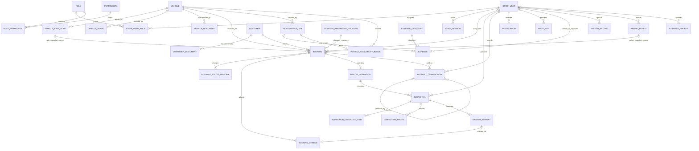

# AJ Car Rentals — Database Schema and Entity Relationship Design

**Status:** Proposal for review. This document does not create a Prisma schema, migration, or database objects.  
**Target:** MySQL 8, Prisma ORM, Node.js 22, JavaScript ES modules.  
**Scope:** Persistent data design for the backend. The frontend remains a separate repository and does not access MySQL directly.

## 1. Design goals and assumptions

- Use relational tables for transactional and authorization data. Use JSON only for versioned policy snapshots, flexible settings, and audit/notification payloads.
- Use UUID string primary keys (`CHAR(36)`) generated by Prisma. This keeps IDs portable across environments and avoids exposing sequential identifiers through the public API.
- Use `DECIMAL(12,2)` for LKR amounts, never floating-point values. The maximum stored amount is sufficient for ordinary rental transactions; the business should confirm this ceiling before implementation.
- Store event times as UTC in MySQL `DATETIME(3)`. MySQL `DATETIME` has no timezone semantics. The API must parse timezone-aware input, convert to UTC before persistence, and render customer-facing dates in `Asia/Colombo`. Date-only values such as licence expiry remain `DATE`.
- Record LKR as the explicit currency for each monetary transaction or agreed booking price. Do not silently reinterpret historical amounts if a future currency setting changes.
- Keep vehicles, customers, bookings, payment transactions, expenses, maintenance records, and audit records through soft deactivation/archival rather than permanent deletion. Historical foreign keys use `RESTRICT` where deletion would destroy transaction context.
- Store customer NIC and driving licence numbers encrypted at the application layer. Store a keyed, non-reversible lookup hash when exact duplicate detection is required. File rows contain private storage keys and metadata, not public URLs.
- One booking reserves exactly one vehicle. Pending requests do not reserve availability. This design does not implement temporary holds.
- Customer self-service accounts, deposits held outside rental payments, taxes/VAT rules, and integrations to external payment processors are not assumed. No card numbers or security codes are stored.

## 2. Entity list and purpose

| Entity | Purpose |
|---|---|
| `StaffUser` | Staff identity, login credentials, activation and account lifecycle. |
| `Role` | Named authorization role; seed `ADMIN`, `MANAGER`, and `MAINTAINER`. |
| `Permission` | Fine-grained permission identifier and description. |
| `StaffUserRole` | Many-to-many assignment of roles to staff users. |
| `RolePermission` | Many-to-many mapping of roles to permissions. |
| `StaffSession` | Hashed, expiring, revocable staff session. |
| `Vehicle` | Fleet identity, registration, specifications, status and lifecycle. |
| `VehicleRatePlan` | Effective-dated daily, weekly, or monthly rates and mileage terms. |
| `VehicleImage` | Vehicle marketing images with publication state and private storage key. |
| `VehicleDocument` | Private vehicle registration, insurance and related document metadata. |
| `Customer` | Customer contact and encrypted identity/licence details. |
| `CustomerDocument` | Private customer-document metadata and storage reference. |
| `BookingReferenceCounter` | Transactionally allocated yearly booking reference sequence. |
| `Booking` | Request, confirmed rental, immutable price/customer snapshots, and lifecycle. |
| `BookingStatusHistory` | Append-only record of booking status transitions and actors. |
| `BookingCharge` | Post-confirmation debit/credit adjustment, including damage and late charges. |
| `RentalOperation` | One booking’s handover/return times, mileage and fuel readings. |
| `Inspection` | Handover, return, or additional inspection and customer acknowledgement. |
| `InspectionChecklistItem` | Condition/finding for an item inspected on a vehicle. |
| `InspectionPhoto` | Private photo metadata associated with an inspection. |
| `DamageReport` | Existing or newly discovered damage recorded during an inspection. |
| `PaymentTransaction` | Collection or refund transaction; many transactions per booking. |
| `MaintenanceJob` | Service/repair lifecycle and next-service reminders. |
| `VehicleAvailabilityBlock` | Half-open period during which a vehicle is unavailable for another reason. |
| `ExpenseCategory` | Configurable classification of operating expenses. |
| `Expense` | Expense amount, approval, receipt metadata and optional maintenance link. |
| `Notification` | Staff-facing notification/inbox item. |
| `AuditLog` | Durable actor/action record for sensitive and important changes. |
| `BusinessProfile` | Business name, contact information, timezone and reporting currency. |
| `RentalPolicy` | Versioned rental terms and policy effective dates. |
| `SystemSetting` | Typed-by-convention JSON value for non-secret configurable settings. |

### Relationship cardinalities

- A staff user has zero or more roles; a role has zero or more staff users (`StaffUserRole`).
- A role has zero or more permissions; a permission can belong to zero or more roles (`RolePermission`).
- A staff user has zero or more sessions; revoking or deactivating the user invalidates their sessions.
- A vehicle has many rate plans, images, documents, bookings, maintenance jobs, and availability blocks.
- A customer has many bookings and private documents. A booking has exactly one customer and one vehicle.
- A booking has many status-history rows, payment transactions, and post-confirmation charges; it has zero or one rental operation.
- A rental operation has many inspections; each inspection has many checklist items, photos, and damage reports.
- A payment refund references its original collection transaction. One collection may have multiple partial refunds.
- A maintenance job has zero or more expenses. Maintenance costs are reported from `Expense` rows only.
- An availability block belongs to one vehicle and may optionally correspond to one maintenance job.
- Staff users may create/approve records. Historical actor references are retained; staff accounts should be deactivated, not deleted.

## 3. Mermaid ER diagram

The diagram omits non-key fields for readability. `StaffUserRole`, `RolePermission`, status history, and media entities are shown explicitly.



## 4. Detailed Prisma schema proposal

This is a reviewable schema draft, not an installed or validated Prisma schema. The `url` datasource form is conventional for Prisma versions that read the connection URL from `schema.prisma`; confirm the selected Prisma major version and its configuration format when implementation is approved.

```prisma
generator client {
  provider = "prisma-client-js"
}

datasource db {
  provider = "mysql"
  url      = env("DATABASE_URL")
}

enum VehicleStatus {
  ACTIVE
  INACTIVE
  RETIRED
}

enum Transmission {
  MANUAL
  AUTOMATIC
  OTHER
}

enum FuelType {
  PETROL
  DIESEL
  HYBRID
  ELECTRIC
  LPG
  OTHER
}

enum RatePeriod {
  DAILY
  WEEKLY
  MONTHLY
}

enum VehicleDocumentType {
  REGISTRATION
  INSURANCE
  REVENUE_LICENSE
  EMISSION_CERTIFICATE
  OTHER
}

enum CustomerDocumentType {
  NIC_FRONT
  NIC_BACK
  DRIVING_LICENCE_FRONT
  DRIVING_LICENCE_BACK
  OTHER
}

enum BookingStatus {
  PENDING
  CONFIRMED
  REJECTED
  CANCELLED
  IN_PROGRESS
  COMPLETED
  NO_SHOW
}

enum BookingSource {
  PUBLIC_WEBSITE
  STAFF_PORTAL
  PHONE
  WHATSAPP
  OTHER
}

enum BookingChargeDirection {
  DEBIT
  CREDIT
}

enum BookingChargeKind {
  EXTRA_KILOMETRE
  LATE_RETURN
  DAMAGE
  CLEANING
  DELIVERY
  DISCOUNT
  OTHER
}

enum InspectionType {
  HANDOVER
  RETURN
  ADDITIONAL
}

enum InspectionCondition {
  GOOD
  MINOR_ISSUE
  DAMAGED
  NOT_APPLICABLE
}

enum AcknowledgementMethod {
  SIGNATURE
  PIN
  IN_PERSON
  OTHER
}

enum DamageOrigin {
  EXISTING
  NEW
}

enum DamageSeverity {
  LOW
  MEDIUM
  HIGH
}

enum PaymentDirection {
  COLLECTION
  REFUND
}

enum PaymentStatus {
  PENDING
  COMPLETED
  FAILED
  VOIDED
}

enum PaymentMethod {
  CASH
  BANK_TRANSFER
  CARD
}

enum PaymentPurpose {
  ADVANCE
  PARTIAL
  FINAL
  ADDITIONAL_CHARGE
  SECURITY_DEPOSIT
  OTHER
}

enum MaintenanceType {
  ROUTINE_SERVICE
  REPAIR
  INSPECTION
  TYRE
  OTHER
}

enum MaintenanceStatus {
  PLANNED
  SCHEDULED
  IN_PROGRESS
  COMPLETED
  CANCELLED
}

enum AvailabilityBlockStatus {
  ACTIVE
  RELEASED
  CANCELLED
}

enum ExpenseApprovalStatus {
  PENDING
  APPROVED
  REJECTED
}

enum NotificationType {
  BOOKING_CREATED
  BOOKING_STATUS_CHANGED
  PAYMENT_RECORDED
  RENTAL_HANDOVER
  RENTAL_RETURN
  MAINTENANCE_DUE
  EXPENSE_SUBMITTED
  OTHER
}

model StaffUser {
  id                 String    @id @default(uuid()) @db.Char(36)
  emailNormalized    String    @unique @db.VarChar(254)
  displayName        String    @db.VarChar(160)
  passwordHash       String    @db.VarChar(255)
  isActive           Boolean   @default(true)
  passwordChangedAt  DateTime? @db.DateTime(3)
  lastLoginAt        DateTime? @db.DateTime(3)
  lockedUntil        DateTime? @db.DateTime(3)
  createdAt          DateTime  @default(now()) @db.DateTime(3)
  updatedAt          DateTime  @updatedAt @db.DateTime(3)
  deactivatedAt      DateTime? @db.DateTime(3)

  roleLinks                   StaffUserRole[]
  sessions                    StaffSession[]
  createdBookings             Booking[]                 @relation("BookingCreator")
  confirmedBookings           Booking[]                 @relation("BookingConfirmer")
  rejectedBookings            Booking[]                 @relation("BookingRejecter")
  cancelledBookings           Booking[]                 @relation("BookingCanceller")
  bookingStatusChanges        BookingStatusHistory[]    @relation("BookingStatusActor")
  createdBookingCharges       BookingCharge[]           @relation("BookingChargeCreator")
  handovers                   RentalOperation[]         @relation("RentalHandoverStaff")
  returns                     RentalOperation[]         @relation("RentalReturnStaff")
  inspections                 Inspection[]              @relation("InspectionStaff")
  uploadedCustomerDocuments   CustomerDocument[]        @relation("CustomerDocumentUploader")
  recordedPayments            PaymentTransaction[]      @relation("PaymentRecorder")
  createdMaintenanceJobs      MaintenanceJob[]          @relation("MaintenanceCreator")
  createdAvailabilityBlocks   VehicleAvailabilityBlock[] @relation("AvailabilityBlockCreator")
  submittedExpenses            Expense[]                 @relation("ExpenseSubmitter")
  approvedExpenses             Expense[]                 @relation("ExpenseApprover")
  notifications                Notification[]            @relation("NotificationRecipient")
  auditLogs                    AuditLog[]                @relation("AuditActor")
  updatedSettings              SystemSetting[]           @relation("SettingUpdater")
  createdPolicies              RentalPolicy[]            @relation("PolicyCreator")
  updatedBusinessProfiles      BusinessProfile[]         @relation("BusinessProfileUpdater")

  @@index([isActive, deactivatedAt])
}

model Role {
  id          String   @id @default(uuid()) @db.Char(36)
  code        String   @unique @db.VarChar(40)
  name        String   @db.VarChar(100)
  description String?  @db.VarChar(500)
  isSystem    Boolean  @default(false)
  createdAt   DateTime @default(now()) @db.DateTime(3)
  updatedAt   DateTime @updatedAt @db.DateTime(3)

  staffLinks      StaffUserRole[]
  permissionLinks RolePermission[]
}

model Permission {
  id          String   @id @default(uuid()) @db.Char(36)
  code        String   @unique @db.VarChar(100)
  description String?  @db.VarChar(500)
  createdAt   DateTime @default(now()) @db.DateTime(3)

  roleLinks RolePermission[]
}

model StaffUserRole {
  staffUserId String   @db.Char(36)
  roleId      String   @db.Char(36)
  assignedAt  DateTime @default(now()) @db.DateTime(3)

  staffUser StaffUser @relation(fields: [staffUserId], references: [id], onDelete: Cascade, onUpdate: Cascade)
  role      Role      @relation(fields: [roleId], references: [id], onDelete: Cascade, onUpdate: Cascade)

  @@id([staffUserId, roleId])
  @@index([roleId, staffUserId])
}

model RolePermission {
  roleId       String   @db.Char(36)
  permissionId String   @db.Char(36)
  grantedAt    DateTime @default(now()) @db.DateTime(3)

  role       Role       @relation(fields: [roleId], references: [id], onDelete: Cascade, onUpdate: Cascade)
  permission Permission @relation(fields: [permissionId], references: [id], onDelete: Cascade, onUpdate: Cascade)

  @@id([roleId, permissionId])
  @@index([permissionId, roleId])
}

model StaffSession {
  id          String    @id @default(uuid()) @db.Char(36)
  staffUserId String    @db.Char(36)
  tokenHash   String    @unique @db.Char(64)
  createdAt   DateTime  @default(now()) @db.DateTime(3)
  lastUsedAt  DateTime? @db.DateTime(3)
  expiresAt   DateTime  @db.DateTime(3)
  revokedAt   DateTime? @db.DateTime(3)
  ipAddress   String?   @db.VarChar(45)
  userAgent   String?   @db.VarChar(512)

  staffUser StaffUser @relation(fields: [staffUserId], references: [id], onDelete: Cascade, onUpdate: Cascade)

  @@index([staffUserId, revokedAt, expiresAt])
  @@index([expiresAt])
}

model Vehicle {
  id                  String         @id @default(uuid()) @db.Char(36)
  registrationNumber  String         @unique @db.VarChar(24)
  chassisNumber       String?        @unique @db.VarChar(64)
  make                String         @db.VarChar(80)
  model               String         @db.VarChar(100)
  modelYear           Int?           @db.UnsignedSmallInt
  engineCc            Int?           @db.UnsignedSmallInt
  transmission        Transmission
  fuelType            FuelType
  seatCount           Int?           @db.UnsignedTinyInt
  color               String?        @db.VarChar(50)
  description         String?        @db.Text
  status              VehicleStatus  @default(ACTIVE)
  createdAt           DateTime       @default(now()) @db.DateTime(3)
  updatedAt           DateTime       @updatedAt @db.DateTime(3)
  retiredAt           DateTime?      @db.DateTime(3)

  ratePlans        VehicleRatePlan[]
  images           VehicleImage[]
  documents        VehicleDocument[]
  bookings         Booking[]
  maintenanceJobs  MaintenanceJob[]
  availabilityBlocks VehicleAvailabilityBlock[]

  @@index([status, make, model])
  @@index([status, modelYear])
}

model VehicleRatePlan {
  id                    String     @id @default(uuid()) @db.Char(36)
  vehicleId             String     @db.Char(36)
  period                RatePeriod
  amount                Decimal    @db.Decimal(12, 2)
  currency              String     @default("LKR") @db.Char(3)
  mileageAllowanceKm    Int        @db.UnsignedInt
  additionalKmRate      Decimal    @db.Decimal(12, 2)
  effectiveFrom         DateTime   @db.DateTime(3)
  effectiveTo           DateTime?  @db.DateTime(3)
  isActive              Boolean    @default(true)
  createdAt             DateTime   @default(now()) @db.DateTime(3)
  updatedAt             DateTime   @updatedAt @db.DateTime(3)

  vehicle  Vehicle   @relation(fields: [vehicleId], references: [id], onDelete: Restrict, onUpdate: Cascade)
  bookings Booking[]

  @@index([vehicleId, period, isActive, effectiveFrom])
  @@index([effectiveTo])
}

model VehicleImage {
  id            String    @id @default(uuid()) @db.Char(36)
  vehicleId     String    @db.Char(36)
  storageKey    String    @unique @db.VarChar(512)
  caption       String?   @db.VarChar(255)
  sortOrder     Int       @default(0)
  isPublished   Boolean   @default(false)
  createdAt     DateTime  @default(now()) @db.DateTime(3)
  deletedAt     DateTime? @db.DateTime(3)

  vehicle Vehicle @relation(fields: [vehicleId], references: [id], onDelete: Restrict, onUpdate: Cascade)

  @@index([vehicleId, isPublished, sortOrder])
}

model VehicleDocument {
  id           String               @id @default(uuid()) @db.Char(36)
  vehicleId    String               @db.Char(36)
  documentType VehicleDocumentType
  storageKey   String               @unique @db.VarChar(512)
  originalName String               @db.VarChar(255)
  mimeType     String               @db.VarChar(100)
  sizeBytes    BigInt               @db.UnsignedBigInt
  expiresAt    DateTime?            @db.DateTime(3)
  uploadedAt   DateTime             @default(now()) @db.DateTime(3)
  deletedAt    DateTime?            @db.DateTime(3)

  vehicle Vehicle @relation(fields: [vehicleId], references: [id], onDelete: Restrict, onUpdate: Cascade)

  @@index([vehicleId, documentType, expiresAt])
}

model Customer {
  id                       String    @id @default(uuid()) @db.Char(36)
  fullName                 String    @db.VarChar(160)
  phone                    String    @db.VarChar(32)
  email                    String?   @db.VarChar(254)
  addressLine1             String?   @db.VarChar(160)
  addressLine2             String?   @db.VarChar(160)
  city                     String?   @db.VarChar(100)
  nicCiphertext            String?   @db.VarChar(1024)
  nicLookupHash            String?   @unique @db.Char(64)
  licenceCiphertext        String?   @db.VarChar(1024)
  licenceLookupHash        String?   @unique @db.Char(64)
  licenceExpiryDate        DateTime? @db.Date
  createdAt                DateTime  @default(now()) @db.DateTime(3)
  updatedAt                DateTime  @updatedAt @db.DateTime(3)
  archivedAt               DateTime? @db.DateTime(3)

  documents CustomerDocument[]
  bookings  Booking[]

  @@index([phone])
  @@index([email])
  @@index([fullName])
  @@index([archivedAt])
}

model CustomerDocument {
  id                 String               @id @default(uuid()) @db.Char(36)
  customerId         String               @db.Char(36)
  uploadedByStaffId  String?              @db.Char(36)
  documentType       CustomerDocumentType
  storageKey         String               @unique @db.VarChar(512)
  originalName       String               @db.VarChar(255)
  mimeType           String               @db.VarChar(100)
  sizeBytes          BigInt               @db.UnsignedBigInt
  sha256             String?              @db.Char(64)
  expiresAt          DateTime?            @db.Date
  uploadedAt         DateTime             @default(now()) @db.DateTime(3)
  deletedAt          DateTime?            @db.DateTime(3)

  customer  Customer   @relation(fields: [customerId], references: [id], onDelete: Restrict, onUpdate: Cascade)
  uploader  StaffUser? @relation("CustomerDocumentUploader", fields: [uploadedByStaffId], references: [id], onDelete: SetNull, onUpdate: Cascade)

  @@index([customerId, documentType, deletedAt])
  @@index([uploadedByStaffId])
}

model BookingReferenceCounter {
  year         Int      @id @db.UnsignedSmallInt
  lastSequence Int      @default(0) @db.UnsignedInt
  updatedAt    DateTime @updatedAt @db.DateTime(3)

  bookings Booking[]
}

model Booking {
  id                     String        @id @default(uuid()) @db.Char(36)
  referenceYear          Int           @db.UnsignedSmallInt
  referenceSequence      Int           @db.UnsignedInt
  reference              String        @unique @db.VarChar(20)
  customerId             String        @db.Char(36)
  vehicleId              String        @db.Char(36)
  ratePlanId             String?       @db.Char(36)
  rentalPolicyId         String?       @db.Char(36)
  createdByStaffId       String?       @db.Char(36)
  confirmedByStaffId     String?       @db.Char(36)
  rejectedByStaffId      String?       @db.Char(36)
  cancelledByStaffId     String?       @db.Char(36)
  source                 BookingSource @default(PUBLIC_WEBSITE)
  status                 BookingStatus @default(PENDING)
  pickupAt               DateTime      @db.DateTime(3)
  returnAt               DateTime      @db.DateTime(3)
  customerNameSnapshot   String        @db.VarChar(160)
  customerPhoneSnapshot  String        @db.VarChar(32)
  customerEmailSnapshot  String?       @db.VarChar(254)
  registrationSnapshot   String        @db.VarChar(24)
  ratePeriodSnapshot     RatePeriod
  rateAmountSnapshot     Decimal       @db.Decimal(12, 2)
  rentalUnitsSnapshot    Decimal       @db.Decimal(8, 2)
  mileageAllowanceKmSnapshot Int       @db.UnsignedInt
  additionalKmRateSnapshot Decimal     @db.Decimal(12, 2)
  rentalSubtotal         Decimal       @db.Decimal(12, 2)
  discountAmount         Decimal       @default(0) @db.Decimal(12, 2)
  taxAmount              Decimal       @default(0) @db.Decimal(12, 2)
  agreedTotal            Decimal       @db.Decimal(12, 2)
  currency               String        @default("LKR") @db.Char(3)
  policySnapshot         Json?
  customerNotes          String?       @db.Text
  rejectionReason        String?       @db.VarChar(1000)
  rejectedAt             DateTime?     @db.DateTime(3)
  cancellationReason    String?       @db.VarChar(1000)
  cancelledAt            DateTime?     @db.DateTime(3)
  confirmedAt            DateTime?     @db.DateTime(3)
  createdAt              DateTime      @default(now()) @db.DateTime(3)
  updatedAt              DateTime      @updatedAt @db.DateTime(3)

  customer          Customer                 @relation(fields: [customerId], references: [id], onDelete: Restrict, onUpdate: Cascade)
  vehicle           Vehicle                  @relation(fields: [vehicleId], references: [id], onDelete: Restrict, onUpdate: Cascade)
  ratePlan          VehicleRatePlan?         @relation(fields: [ratePlanId], references: [id], onDelete: SetNull, onUpdate: Cascade)
  rentalPolicy      RentalPolicy?            @relation(fields: [rentalPolicyId], references: [id], onDelete: SetNull, onUpdate: Cascade)
  referenceCounter  BookingReferenceCounter  @relation(fields: [referenceYear], references: [year], onDelete: Restrict, onUpdate: Cascade)
  createdBy         StaffUser?               @relation("BookingCreator", fields: [createdByStaffId], references: [id], onDelete: SetNull, onUpdate: Cascade)
  confirmedBy       StaffUser?               @relation("BookingConfirmer", fields: [confirmedByStaffId], references: [id], onDelete: SetNull, onUpdate: Cascade)
  rejectedBy        StaffUser?               @relation("BookingRejecter", fields: [rejectedByStaffId], references: [id], onDelete: SetNull, onUpdate: Cascade)
  cancelledBy       StaffUser?               @relation("BookingCanceller", fields: [cancelledByStaffId], references: [id], onDelete: SetNull, onUpdate: Cascade)
  statusHistory     BookingStatusHistory[]
  charges           BookingCharge[]
  rentalOperation   RentalOperation?
  paymentTransactions PaymentTransaction[]

  @@unique([referenceYear, referenceSequence])
  @@index([vehicleId, status, pickupAt, returnAt])
  @@index([customerId, createdAt])
  @@index([status, pickupAt])
  @@index([createdAt])
}

model BookingStatusHistory {
  id                    String        @id @default(uuid()) @db.Char(36)
  bookingId             String        @db.Char(36)
  changedByStaffId      String?       @db.Char(36)
  fromStatus            BookingStatus?
  toStatus              BookingStatus
  reason                String?       @db.VarChar(1000)
  occurredAt            DateTime      @default(now()) @db.DateTime(3)

  booking      Booking    @relation(fields: [bookingId], references: [id], onDelete: Restrict, onUpdate: Cascade)
  changedBy    StaffUser? @relation("BookingStatusActor", fields: [changedByStaffId], references: [id], onDelete: SetNull, onUpdate: Cascade)

  @@index([bookingId, occurredAt])
  @@index([changedByStaffId, occurredAt])
}

model BookingCharge {
  id                    String                @id @default(uuid()) @db.Char(36)
  bookingId             String                @db.Char(36)
  createdByStaffId      String                @db.Char(36)
  damageReportId        String?               @unique @db.Char(36)
  direction             BookingChargeDirection
  kind                  BookingChargeKind
  amount                Decimal               @db.Decimal(12, 2)
  currency              String                @default("LKR") @db.Char(3)
  description           String                @db.VarChar(1000)
  createdAt             DateTime              @default(now()) @db.DateTime(3)
  voidedAt              DateTime?             @db.DateTime(3)
  voidReason            String?               @db.VarChar(1000)

  booking       Booking       @relation(fields: [bookingId], references: [id], onDelete: Restrict, onUpdate: Cascade)
  createdBy     StaffUser     @relation("BookingChargeCreator", fields: [createdByStaffId], references: [id], onDelete: Restrict, onUpdate: Cascade)
  damageReport  DamageReport? @relation(fields: [damageReportId], references: [id], onDelete: SetNull, onUpdate: Cascade)

  @@index([bookingId, createdAt, voidedAt])
  @@index([createdByStaffId, createdAt])
}

model RentalOperation {
  id                  String    @id @default(uuid()) @db.Char(36)
  bookingId           String    @unique @db.Char(36)
  handedOverByStaffId String?   @db.Char(36)
  returnedByStaffId   String?   @db.Char(36)
  handedOverAt        DateTime? @db.DateTime(3)
  returnedAt          DateTime? @db.DateTime(3)
  startOdometerKm     Int?      @db.UnsignedInt
  endOdometerKm       Int?      @db.UnsignedInt
  startFuelPercent    Decimal?  @db.Decimal(5, 2)
  endFuelPercent      Decimal?  @db.Decimal(5, 2)
  createdAt           DateTime  @default(now()) @db.DateTime(3)
  updatedAt           DateTime  @updatedAt @db.DateTime(3)

  booking       Booking       @relation(fields: [bookingId], references: [id], onDelete: Restrict, onUpdate: Cascade)
  handedOverBy  StaffUser?    @relation("RentalHandoverStaff", fields: [handedOverByStaffId], references: [id], onDelete: SetNull, onUpdate: Cascade)
  returnedBy    StaffUser?    @relation("RentalReturnStaff", fields: [returnedByStaffId], references: [id], onDelete: SetNull, onUpdate: Cascade)
  inspections   Inspection[]

  @@index([handedOverAt])
  @@index([returnedAt])
}

model Inspection {
  id                         String            @id @default(uuid()) @db.Char(36)
  rentalOperationId          String            @db.Char(36)
  inspectedByStaffId         String            @db.Char(36)
  inspectionType             InspectionType
  inspectedAt                DateTime          @default(now()) @db.DateTime(3)
  notes                      String?           @db.Text
  customerAcknowledgedAt     DateTime?         @db.DateTime(3)
  acknowledgementMethod      AcknowledgementMethod?
  acknowledgementStorageKey  String?           @db.VarChar(512)
  createdAt                  DateTime          @default(now()) @db.DateTime(3)

  rentalOperation RentalOperation          @relation(fields: [rentalOperationId], references: [id], onDelete: Restrict, onUpdate: Cascade)
  inspectedBy     StaffUser                @relation("InspectionStaff", fields: [inspectedByStaffId], references: [id], onDelete: Restrict, onUpdate: Cascade)
  checklistItems  InspectionChecklistItem[]
  photos          InspectionPhoto[]
  damages         DamageReport[]

  @@index([rentalOperationId, inspectionType, inspectedAt])
  @@index([inspectedByStaffId, inspectedAt])
}

model InspectionChecklistItem {
  id           String              @id @default(uuid()) @db.Char(36)
  inspectionId String              @db.Char(36)
  itemKey      String              @db.VarChar(80)
  condition    InspectionCondition
  notes        String?             @db.VarChar(1000)
  createdAt    DateTime            @default(now()) @db.DateTime(3)

  inspection Inspection @relation(fields: [inspectionId], references: [id], onDelete: Restrict, onUpdate: Cascade)

  @@unique([inspectionId, itemKey])
  @@index([inspectionId, condition])
}

model InspectionPhoto {
  id           String   @id @default(uuid()) @db.Char(36)
  inspectionId String   @db.Char(36)
  storageKey   String   @unique @db.VarChar(512)
  caption      String?  @db.VarChar(255)
  mimeType     String   @db.VarChar(100)
  sizeBytes    BigInt   @db.UnsignedBigInt
  sha256       String?  @db.Char(64)
  capturedAt   DateTime? @db.DateTime(3)
  createdAt    DateTime @default(now()) @db.DateTime(3)

  inspection Inspection @relation(fields: [inspectionId], references: [id], onDelete: Restrict, onUpdate: Cascade)

  @@index([inspectionId, createdAt])
}

model DamageReport {
  id              String         @id @default(uuid()) @db.Char(36)
  inspectionId    String         @db.Char(36)
  origin          DamageOrigin
  severity        DamageSeverity
  description     String         @db.VarChar(2000)
  location        String?        @db.VarChar(160)
  resolvedAt      DateTime?      @db.DateTime(3)
  createdAt       DateTime       @default(now()) @db.DateTime(3)
  updatedAt       DateTime       @updatedAt @db.DateTime(3)

  inspection Inspection    @relation(fields: [inspectionId], references: [id], onDelete: Restrict, onUpdate: Cascade)
  charge     BookingCharge?

  @@index([inspectionId, origin, severity])
  @@index([resolvedAt])
}

model PaymentTransaction {
  id                String           @id @default(uuid()) @db.Char(36)
  bookingId         String           @db.Char(36)
  recordedByStaffId String           @db.Char(36)
  originalPaymentId String?          @db.Char(36)
  direction         PaymentDirection
  purpose           PaymentPurpose
  status            PaymentStatus    @default(PENDING)
  method            PaymentMethod
  amount            Decimal          @db.Decimal(12, 2)
  currency          String           @default("LKR") @db.Char(3)
  reference         String?          @db.VarChar(160)
  idempotencyKey    String?          @unique @db.VarChar(100)
  notes             String?          @db.VarChar(1000)
  recordedAt        DateTime         @default(now()) @db.DateTime(3)
  settledAt         DateTime?        @db.DateTime(3)
  voidedAt          DateTime?        @db.DateTime(3)

  booking       Booking             @relation(fields: [bookingId], references: [id], onDelete: Restrict, onUpdate: Cascade)
  recordedBy    StaffUser           @relation("PaymentRecorder", fields: [recordedByStaffId], references: [id], onDelete: Restrict, onUpdate: Cascade)
  original      PaymentTransaction? @relation("PaymentRefunds", fields: [originalPaymentId], references: [id], onDelete: Restrict, onUpdate: Cascade)
  refunds       PaymentTransaction[] @relation("PaymentRefunds")

  @@index([bookingId, status, direction, settledAt])
  @@index([recordedByStaffId, recordedAt])
  @@index([originalPaymentId])
  @@index([reference])
}

model MaintenanceJob {
  id                       String           @id @default(uuid()) @db.Char(36)
  vehicleId                String           @db.Char(36)
  createdByStaffId         String           @db.Char(36)
  maintenanceType          MaintenanceType
  status                   MaintenanceStatus @default(PLANNED)
  summary                  String           @db.VarChar(255)
  description              String?          @db.Text
  vendorName               String?          @db.VarChar(160)
  scheduledStartAt         DateTime?         @db.DateTime(3)
  estimatedCompletionAt    DateTime?         @db.DateTime(3)
  actualStartAt            DateTime?         @db.DateTime(3)
  completedAt              DateTime?         @db.DateTime(3)
  nextServiceAt            DateTime?         @db.DateTime(3)
  nextServiceOdometerKm    Int?              @db.UnsignedInt
  createdAt                DateTime          @default(now()) @db.DateTime(3)
  updatedAt                DateTime          @updatedAt @db.DateTime(3)
  cancelledAt              DateTime?         @db.DateTime(3)

  vehicle          Vehicle                  @relation(fields: [vehicleId], references: [id], onDelete: Restrict, onUpdate: Cascade)
  createdBy        StaffUser                @relation("MaintenanceCreator", fields: [createdByStaffId], references: [id], onDelete: Restrict, onUpdate: Cascade)
  availabilityBlock VehicleAvailabilityBlock?
  expenses         Expense[]

  @@index([vehicleId, status, scheduledStartAt])
  @@index([status, nextServiceAt])
  @@index([status, nextServiceOdometerKm])
}

model VehicleAvailabilityBlock {
  id                    String                  @id @default(uuid()) @db.Char(36)
  vehicleId             String                  @db.Char(36)
  maintenanceJobId      String?                 @unique @db.Char(36)
  createdByStaffId      String?                 @db.Char(36)
  startsAt              DateTime                @db.DateTime(3)
  endsAt                DateTime?               @db.DateTime(3)
  reason                String                  @db.VarChar(500)
  status                AvailabilityBlockStatus @default(ACTIVE)
  createdAt             DateTime                @default(now()) @db.DateTime(3)
  releasedAt            DateTime?               @db.DateTime(3)

  vehicle       Vehicle        @relation(fields: [vehicleId], references: [id], onDelete: Restrict, onUpdate: Cascade)
  maintenanceJob MaintenanceJob? @relation(fields: [maintenanceJobId], references: [id], onDelete: Restrict, onUpdate: Cascade)
  createdBy     StaffUser?     @relation("AvailabilityBlockCreator", fields: [createdByStaffId], references: [id], onDelete: SetNull, onUpdate: Cascade)

  @@index([vehicleId, status, startsAt, endsAt])
  @@index([status, startsAt, endsAt])
}

model ExpenseCategory {
  id        String   @id @default(uuid()) @db.Char(36)
  code      String   @unique @db.VarChar(60)
  name      String   @db.VarChar(120)
  isActive  Boolean  @default(true)
  createdAt DateTime @default(now()) @db.DateTime(3)
  updatedAt DateTime @updatedAt @db.DateTime(3)

  expenses Expense[]
}

model Expense {
  id                    String                @id @default(uuid()) @db.Char(36)
  categoryId            String                @db.Char(36)
  maintenanceJobId      String?               @db.Char(36)
  submittedByStaffId    String                @db.Char(36)
  approvedByStaffId     String?               @db.Char(36)
  amount                Decimal               @db.Decimal(12, 2)
  currency              String                @default("LKR") @db.Char(3)
  incurredAt            DateTime              @db.DateTime(3)
  description           String                @db.VarChar(1000)
  vendorName            String?               @db.VarChar(160)
  vendorInvoiceReference String?              @db.VarChar(160)
  deduplicationKey      String?               @unique @db.Char(64)
  receiptStorageKey     String?               @db.VarChar(512)
  approvalStatus        ExpenseApprovalStatus @default(PENDING)
  submittedAt           DateTime              @default(now()) @db.DateTime(3)
  approvedAt            DateTime?             @db.DateTime(3)
  rejectedAt            DateTime?             @db.DateTime(3)
  approvalNote          String?               @db.VarChar(1000)

  category       ExpenseCategory @relation(fields: [categoryId], references: [id], onDelete: Restrict, onUpdate: Cascade)
  maintenanceJob MaintenanceJob? @relation(fields: [maintenanceJobId], references: [id], onDelete: Restrict, onUpdate: Cascade)
  submittedBy    StaffUser       @relation("ExpenseSubmitter", fields: [submittedByStaffId], references: [id], onDelete: Restrict, onUpdate: Cascade)
  approvedBy     StaffUser?      @relation("ExpenseApprover", fields: [approvedByStaffId], references: [id], onDelete: Restrict, onUpdate: Cascade)

  @@index([incurredAt, approvalStatus])
  @@index([categoryId, incurredAt, approvalStatus])
  @@index([maintenanceJobId, incurredAt])
  @@index([submittedByStaffId, submittedAt])
}

model Notification {
  id             String           @id @default(uuid()) @db.Char(36)
  recipientId    String           @db.Char(36)
  notificationType NotificationType
  title          String           @db.VarChar(200)
  body           String?          @db.VarChar(2000)
  subjectType    String?          @db.VarChar(80)
  subjectId      String?          @db.VarChar(64)
  payload        Json?
  createdAt      DateTime         @default(now()) @db.DateTime(3)
  readAt         DateTime?        @db.DateTime(3)

  recipient StaffUser @relation("NotificationRecipient", fields: [recipientId], references: [id], onDelete: Cascade, onUpdate: Cascade)

  @@index([recipientId, readAt, createdAt])
  @@index([notificationType, createdAt])
  @@index([subjectType, subjectId])
}

model AuditLog {
  id                 String   @id @default(uuid()) @db.Char(36)
  actorStaffUserId   String?  @db.Char(36)
  action             String   @db.VarChar(100)
  subjectType        String   @db.VarChar(80)
  subjectId          String   @db.VarChar(64)
  occurredAt         DateTime @default(now()) @db.DateTime(3)
  requestId          String?  @db.VarChar(100)
  ipAddress          String?  @db.VarChar(45)
  userAgent          String?  @db.VarChar(512)
  beforeSnapshot     Json?
  afterSnapshot      Json?

  actor StaffUser? @relation("AuditActor", fields: [actorStaffUserId], references: [id], onDelete: Restrict, onUpdate: Cascade)

  @@index([subjectType, subjectId, occurredAt])
  @@index([actorStaffUserId, occurredAt])
  @@index([action, occurredAt])
  @@index([requestId])
}

model BusinessProfile {
  id                  String   @id @default("default") @db.VarChar(16)
  businessName        String   @db.VarChar(160)
  legalName           String?  @db.VarChar(200)
  registrationNumber  String?  @db.VarChar(100)
  publicPhone         String?  @db.VarChar(32)
  publicEmail         String?  @db.VarChar(254)
  address             String?  @db.VarChar(500)
  businessTimezone    String   @default("Asia/Colombo") @db.VarChar(64)
  reportingCurrency   String   @default("LKR") @db.Char(3)
  updatedByStaffId    String?  @db.Char(36)
  createdAt           DateTime @default(now()) @db.DateTime(3)
  updatedAt           DateTime @updatedAt @db.DateTime(3)

  updatedBy StaffUser? @relation("BusinessProfileUpdater", fields: [updatedByStaffId], references: [id], onDelete: SetNull, onUpdate: Cascade)
}

model RentalPolicy {
  id                    String   @id @default(uuid()) @db.Char(36)
  version               Int      @unique @db.UnsignedInt
  createdByStaffId      String?  @db.Char(36)
  effectiveFrom         DateTime @db.DateTime(3)
  effectiveTo           DateTime? @db.DateTime(3)
  rentalTerms           String   @db.LongText
  cancellationTerms     String   @db.LongText
  minimumRentalHours   Int      @default(1) @db.UnsignedSmallInt
  maximumAdvanceDays   Int?     @db.UnsignedSmallInt
  advancePercent       Decimal? @db.Decimal(5, 2)
  securityDeposit      Decimal? @db.Decimal(12, 2)
  lateReturnGraceMinutes Int    @default(0) @db.UnsignedSmallInt
  createdAt             DateTime @default(now()) @db.DateTime(3)

  createdBy StaffUser? @relation("PolicyCreator", fields: [createdByStaffId], references: [id], onDelete: SetNull, onUpdate: Cascade)
  bookings  Booking[]

  @@index([effectiveFrom, effectiveTo])
}

model SystemSetting {
  key              String   @id @db.VarChar(100)
  value            Json
  description      String?  @db.VarChar(500)
  updatedByStaffId String?  @db.Char(36)
  createdAt        DateTime @default(now()) @db.DateTime(3)
  updatedAt        DateTime @updatedAt @db.DateTime(3)

  updatedBy StaffUser? @relation("SettingUpdater", fields: [updatedByStaffId], references: [id], onDelete: SetNull, onUpdate: Cascade)

  @@index([updatedByStaffId, updatedAt])
}
```

## 5. Constraints, indexes, and lifecycle rules

### Database-level constraints

Prisma models express primary keys, foreign keys, unique constraints, and ordinary indexes above. Add MySQL `CHECK` constraints in the eventual migration for invariants that Prisma schema syntax does not express:

- `Booking.pickupAt < Booking.returnAt`.
- `VehicleRatePlan.amount >= 0`, `additionalKmRate >= 0`, and when present `effectiveTo > effectiveFrom`.
- `Booking` monetary values are non-negative; `discountAmount <= rentalSubtotal + taxAmount` where that is the chosen pricing model.
- `BookingCharge.amount > 0`; voiding is represented by `voidedAt`, not by a negative amount.
- `PaymentTransaction.amount > 0`; collection/refund direction is explicit.
- `RentalOperation.endOdometerKm >= startOdometerKm` when both exist.
- Fuel percentages are between 0 and 100.
- `VehicleAvailabilityBlock.endsAt > startsAt` when `endsAt` is set.
- `Expense.amount > 0`.
- `RentalPolicy` percentages and duration values are within configured business bounds.

The application must enforce multi-row and conditional invariants which a normal MySQL `CHECK` cannot express: status transitions, correct actor for confirmation/rejection, refund total not exceeding a collection, and consistency between a damage charge and its booking.

### Index rationale

The schema includes indexes for common access paths:

- Availability queries: `(vehicleId, status, pickupAt, returnAt)` on bookings and `(vehicleId, status, startsAt, endsAt)` on blocks.
- Staff authentication: unique normalized email, unique token hash, and `(staffUserId, revokedAt, expiresAt)` for valid sessions.
- Customer history: `(customerId, createdAt)` on bookings.
- Staff dashboards: `(status, pickupAt)` on bookings; `(incurredAt, approvalStatus)` on expenses.
- Vehicle public listing: `(status, make, model)` and `(status, modelYear)`.
- Maintenance queues/reminders: vehicle/status/scheduled time and status/next-service time or mileage.
- Audit review: `(subjectType, subjectId, occurredAt)`, `(actorStaffUserId, occurredAt)`, and `(action, occurredAt)`.

Avoid adding indexes to every column: they increase write cost and storage. Confirm additional indexes with representative query plans after the API query patterns are known.

MySQL does not provide a simple partial unique index for “one published primary image per vehicle.” If a primary-image flag is added, enforce at most one primary image per vehicle in the service transaction (or use a separately modeled primary-image pointer); do not assume an ordinary composite unique index can express the conditional rule.

### Delete and update behaviour

- Vehicle and customer relations from bookings use `RESTRICT`; archive them instead of deleting.
- Booking financial and operational records use `RESTRICT`; payment transactions and expenses are never cascade-deleted.
- Status history, inspections, damages, receipts, and audit logs are retained. Apply retention/anonymization rules deliberately rather than deleting related rows.
- Join tables (`StaffUserRole`, `RolePermission`) use cascade only for removal of a join assignment. Deactivate staff and roles instead of deleting system roles.
- Sessions cascade when a staff account is removed; ordinary operations should deactivate staff instead. Audit actor references use `RESTRICT` so hard deletion cannot erase attribution. Other optional actor references use `SET NULL` only where the corresponding audit event preserves the actor identity.
- Rate plans and policies are versioned/deactivated. Booking snapshots survive if their optional source FK is later cleared.
- `onUpdate: Cascade` is specified consistently, but primary identifiers should not be changed after creation.

## 6. Booking references, availability, and concurrency

### Reference generation

The required reference format is `AJR-YYYY-000001`. Allocate `BookingReferenceCounter.lastSequence` inside the same transaction that creates the booking:

1. Derive the reference year from the booking creation instant in the agreed business timezone (`Asia/Colombo` is the proposed default), not from an arbitrary client value.
2. Lock or atomically update the counter row for that year, increment its sequence, and use the returned value.
3. Insert the booking with `referenceYear`, `referenceSequence`, and formatted `reference`.
4. Keep both `reference` and `(referenceYear, referenceSequence)` unique. Gaps after failed/void requests are acceptable; never reuse a reference.

### Availability rule

Use half-open intervals: booking `[pickupAt, returnAt)`. Two intervals overlap exactly when:

```text
existing.pickupAt < requested.returnAt
AND existing.returnAt > requested.pickupAt
```

Only confirmed and in-progress bookings reserve the vehicle. `PENDING`, `REJECTED`, `CANCELLED`, `COMPLETED`, and `NO_SHOW` do not block availability. Active vehicle availability blocks (for example, repairs) also prevent confirmation when they overlap the requested interval.

### MySQL concurrency protection

MySQL does not provide a PostgreSQL-style exclusion constraint for arbitrary time-range overlaps. A check-then-insert without locking is race-prone. Confirmation must run in a single Prisma interactive transaction, using `Serializable` isolation where supported and a per-vehicle lock (a locking read such as `SELECT ... FOR UPDATE` on the `Vehicle` row) before checking overlap:

1. Lock the target `Vehicle` row. Every code path that confirms or changes a booking’s reserved vehicle must take the same lock.
2. Query for a blocking booking using the half-open overlap predicate and statuses `CONFIRMED`/`IN_PROGRESS`.
3. Query active availability blocks and confirm none overlap.
4. If clear, transition the booking to `CONFIRMED`, write its status-history and audit rows, and commit.
5. On a serialization/deadlock retryable error, retry the whole transaction a small bounded number of times; surface a conflict if availability changed.

The vehicle-row lock serializes confirmations for one vehicle while allowing unrelated vehicles to proceed concurrently. The overlap query must run after acquiring that lock and inside the same transaction. The database index helps lookup but does not itself enforce the interval invariant. Pending requests are intentionally not holds; if temporary holds are later required, approve hold duration/expiry semantics and add an explicit `BookingHold` entity before implementing them.

## 7. Payments and financial reporting

### Payment ledger and balance

`PaymentTransaction` is append-oriented: record a refund as a new `REFUND` transaction pointing to the original collection; do not edit a completed collection amount or delete it. A refund may be partial, and multiple refund rows may point to one original transaction. `idempotencyKey` prevents duplicate posting when a client retries a payment-recording request.

`purpose` distinguishes `ADVANCE`, `PARTIAL`, `FINAL`, and other payment purposes for operations. It is descriptive, not the source of truth for settlement; the ledger balance determines whether the booking is paid.

For a booking and currency:

```text
netPayments =
    SUM(COMPLETED COLLECTION amounts)
  - SUM(COMPLETED REFUND amounts)

netPostBookingCharges =
    SUM(non-voided DEBIT BookingCharge amounts)
  - SUM(non-voided CREDIT BookingCharge amounts)

amountDue = agreedTotal + netPostBookingCharges - netPayments
```

`amountDue > 0` means outstanding; `amountDue = 0` is settled; `amountDue < 0` is a customer credit/refund due. Only completed transactions affect balances. Pending, failed, and voided transactions remain visible for operations but are excluded. Calculate from ledger rows for authoritative reporting; a cached balance may be introduced only with transactional updates and reconciliation.

Refunds must be performed in a transaction that locks the original collection and booking, sums prior completed refunds, and rejects any refund that exceeds the unrefunded collection amount. Do not store card PAN, CVV, PIN, or online payment credentials; `reference` may hold a bank slip, terminal receipt, or acquirer reference only.

### Revenue and expense reporting

- Rental revenue should be based on confirmed/completed booking agreed totals and explicit adjustments, with a documented recognition rule (for example, on rental completion rather than booking confirmation).
- Cash flow reports use completed collections and refunds by settlement time; accrual/revenue reports use the approved recognition rule. Do not mix the two.
- Exclude voided charges and non-completed payment transactions.
- Report approved expenses by `incurredAt`, category, and currency. Pending/rejected expenses remain available for workflow views but are not included in approved expense totals.
- Maintenance job rows deliberately have **no cost total**. Maintenance spend is `SUM(Expense.amount)` for linked approved expenses. This makes `Expense` the single financial source and prevents the same maintenance cost being added once from the job and again from an expense. One maintenance job can have several expense rows.
- Use an optional unique `deduplicationKey` (e.g. normalized vendor plus invoice/receipt reference) to guard against duplicate expense submissions. The application must define a stable key strategy; missing invoice references cannot be reliably deduplicated automatically.
- Keep currency in all financial records. If multi-currency is ever enabled, define exchange-rate source, rate timestamp, and reporting-currency conversion policy before implementation.

## 8. Security, normalization, and maintainability review

- Authorization data is normalized into roles, permissions, and join tables. Seed the three required role codes, but make permission assignments configurable and enforce them in the backend for each protected operation.
- Store only a hash of a random session token in `StaffSession`; send the raw token only in a secure cookie. Revoke sessions on logout, password reset, account deactivation, and privilege changes as policy requires.
- Encrypt NIC/licence values with authenticated encryption using a key held outside MySQL. Keep a separate keyed HMAC for exact-match lookup; never use an ordinary unsalted hash for identifiers. Restrict and audit access to decrypted values.
- `storageKey` is an opaque private object/file-storage reference, not a URL. Serve private documents only through authenticated, permission-checked endpoints; validate MIME type and size and scan uploads. Public vehicle images should be published through a controlled public-image path, never by exposing private-document storage.
- Audit important booking, payment/refund, handover/return, maintenance, expense approval, authorization, and configuration changes. Do not put passwords, tokens, full identity numbers, document contents, or unnecessary personal data in audit JSON, logs, or notification payloads.
- `AuditLog` should be append-only at the application layer. Consider restricted database permissions or archival export to make tampering harder. Define retention and privacy/anonymization rules before production.
- Snapshot customer contact, registration, rates, mileage terms, agreed totals, and policy terms on the booking so later profile/rate/policy edits do not rewrite historical agreements.
- Keep money, identity and lifecycle facts normalized. JSON is limited to snapshots/settings/metadata where fields are versioned or intentionally flexible, not core relationships used for reporting.

## 9. Decisions requiring approval

Please confirm or amend these assumptions before the schema is implemented:

1. **Business timezone and currency:** use `Asia/Colombo` and `LKR` by default; store instants as UTC.
2. **Rate calculation:** one selected daily/weekly/monthly rate period per booking, with a stored quantity and rate snapshot. Confirm whether mixed packages (for example, weeks plus remaining days) or a monthly billing definition are required.
3. **Pending requests:** pending bookings do not block availability, and no temporary hold is included in this stage.
4. **Confirmation lifecycle:** only `CONFIRMED` and `IN_PROGRESS` bookings block; confirm the intended statuses and allowed transitions, including cancellation after handover.
5. **Customer identity uniqueness:** NIC and licence lookup hashes are unique when supplied. Confirm handling of duplicate/legacy identifiers and how customer erasure/anonymization requests should work.
6. **Payment semantics:** amounts are entered manually as cash, bank transfer, or card-terminal records; no payment gateway or card data storage. Confirm whether security deposits are tracked as booking payments or as a separate liability/return ledger.
7. **Taxes and invoices:** tax amount is snapshot-capable, but tax calculation, tax registration, invoice numbering, and Sri Lankan statutory requirements need accounting/legal confirmation.
8. **Operational rules:** mileage is stored as whole kilometres; fuel is a percentage. Confirm if odometer precision or fuel-level units need another representation.
9. **Retention:** define retention periods for customer documents, audit events, notifications, and payment evidence. Financial/booking history remains non-deletable under ordinary operations.
10. **Staff authorization:** staff may hold multiple roles. Confirm whether each staff account should be restricted to exactly one role.
11. **Reference year boundary:** assign `AJR-YYYY` using the booking creation date in Sri Lanka time, not pickup date; confirm this numbering rule.
12. **Deployment/storage:** confirm where private uploads will live in production (LankaHost filesystem outside web root or private object storage) and the backup/restore requirements.

## 10. Review status and next step

This proposal is designed for review only. No `schema.prisma`, migration, seed code, database connection, dependency installation, or database operation has been created or run. After decisions above are approved, the next stage should translate the accepted design into a Prisma schema and review it with Prisma validation and MySQL-specific constraint checks **before** generating or applying any migration.
